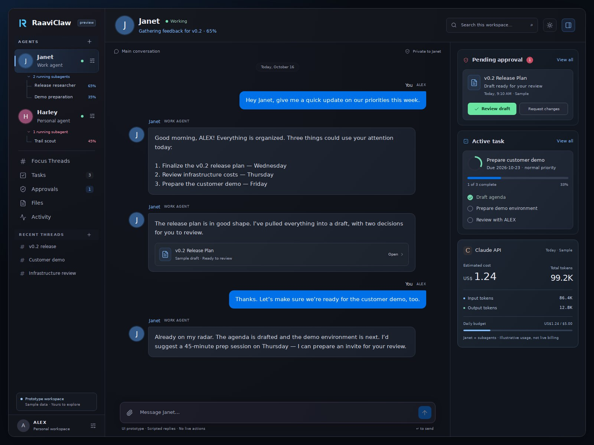
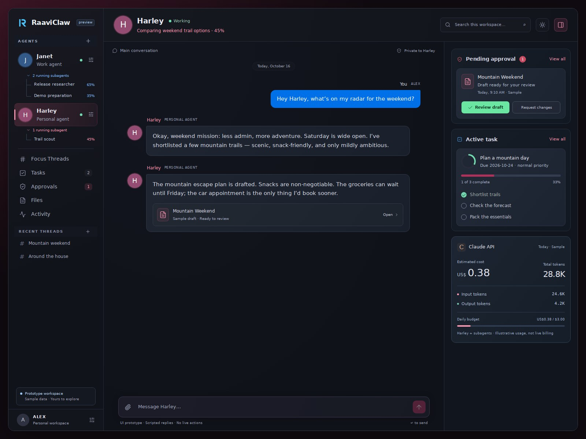
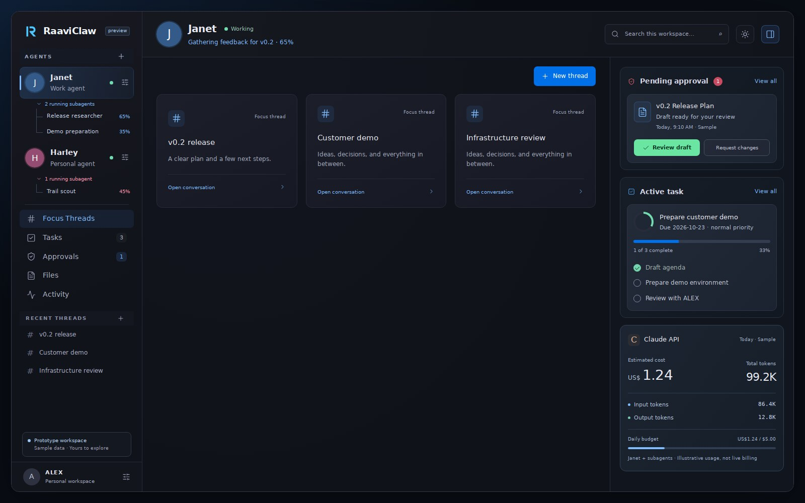
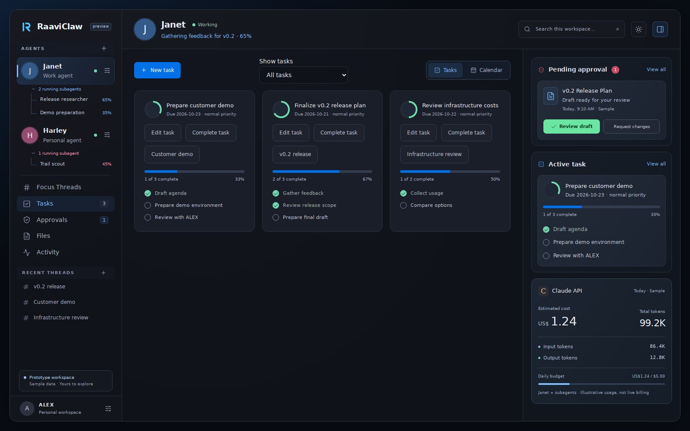
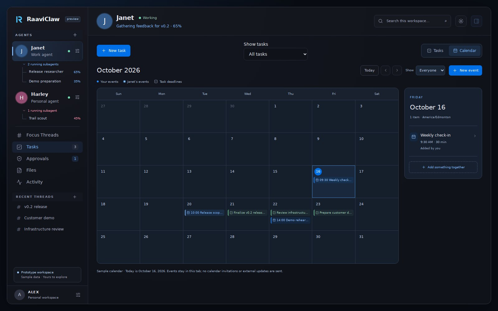
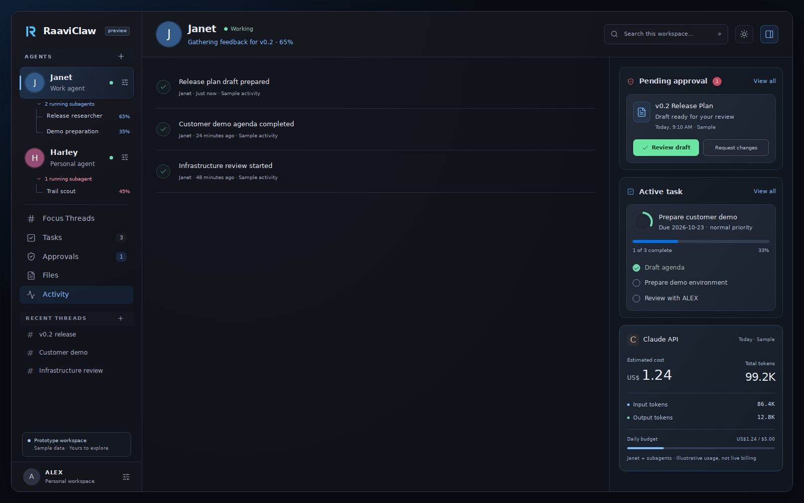

<div align="center">


### Your own team of AI agents. Running on your hardware. Answering to you.

Persistent agents with their own memory, sub-agent workers, and a security model
where **no agent touches your accounts without your approval and a TOTP code.**

[](LICENSE)
[](rust-toolchain.toml)
[](app/)
[](#try-it-locally)
[](#help-finish-it)
[](CONTRIBUTING.md)

[**Try it in 2 minutes**](#try-it-in-2-minutes) ·
[**How it works**](#security-model-n8n-as-the-integration-boundary) ·
[**Help build it**](#help-finish-it) ·
[**Good first issues**](https://github.com/unrealthind/Clawberry/labels/good%20first%20issue)

<br />

<picture>
  <source media="(prefers-color-scheme: light)" srcset="docs/screenshots/janet-chat-light.jpg">
  <source media="(prefers-color-scheme: dark)" srcset="docs/screenshots/janet-chat.jpg">
  
</picture>

<sub>Sample mode with fictional data. Janet (work) and Harley (personal) each run their own sub-agents, visible in the sidebar.</sub>

</div>

---

## Why Clawberry?

Most AI agent setups give a model your API keys and hope it behaves. Clawberry
does the opposite: agents can research, plan and draft on their own, but
**anything that changes the outside world goes through a gate you control.**

<table>
<tr>
<td width="50%" valign="top">

### 🧠 Persistent agents
Each permanent agent has its own identity, conversations, memory, tasks and
permissions. Work and personal stay separate, and nothing crosses between agents
without your review.

</td>
<td width="50%" valign="top">

### 🐝 Sub-agent workers
Agents spin up temporary, scoped workers for research or prep. You watch their
progress live, and results are archived with a full audit trail.

</td>
</tr>
<tr>
<td width="50%" valign="top">

### 🔐 Approval + TOTP for every write
External actions run only through n8n workflows you define. Writes show the exact
action, need your approval, then a one-time code. Undeclared operations are
rejected and everything fails closed.

</td>
<td width="50%" valign="top">

### 🏠 Yours, end to end
A lightweight Rust runtime built for an always-on LXC or VM, plus a polished
React workspace for desktop and phone. Your data stays on your hardware.

</td>
</tr>
<tr>
<td width="50%" valign="top">

### 💬 Chat-first workspace
Focus Threads, tasks, calendar, activity, files, memory and approvals, all in one
place, with light and dark themes.

</td>
<td width="50%" valign="top">

### 📊 Budgets and model routing
Fast, normal and deep model profiles with per-agent daily budgets, so a runaway
worker can't run up your bill.

</td>
</tr>
</table>

> [!NOTE]
> **Early stage, and looking for contributors.** The runtime, memory, tasks, workers,
> security boundaries and most of the UI work locally and are covered by thousands of
> Rust tests plus desktop/phone browser checks. Live integrations, always-on deployment
> and some app features are still unfinished. [Here's where you can help.](#help-finish-it)

## Try it in 2 minutes

No API key needed. This runs the UI with a fictional sample workspace:

```sh
git clone https://github.com/unrealthind/Clawberry.git
cd Clawberry
npm --prefix app ci --ignore-scripts
npm --prefix app run dev
# open http://127.0.0.1:5173/?mode=sample
```

For the full runtime with real chat, see [Try it locally](#try-it-locally).

## Screenshots

<details>
<summary>More screens: Harley, Focus Threads, tasks, calendar and activity</summary>

### Harley — personal agent



### Focus Threads



### Tasks



### Calendar



### Activity



</details>

## What is here

- Separate work and personal assistants, Janet and Harley, with owner-scoped chats,
  tasks, Focus Threads, files and memory.
- Temporary workers, structured results, task archives and model usage budgets.
- A desktop-first responsive chat app with agent settings, activity, memory and
  approval screens.
- Runtime foundations for policy checks, Guard review, secret references, sandboxed
  execution, read-only watches and reviewed n8n contracts.
- Dedicated human approval flows for cross-agent exchanges and TOTP-authorized
  external writes. These require administrator configuration and live acceptance.

Janet and Harley are peers. Their private memory is isolated; exchanging information
requires human approval. Models must not receive raw secrets or bypass policy,
Guard, approvals or the n8n/TOTP write path.

## Security model: n8n as the integration boundary

Agents get the smallest practical permissions. They can research, plan and propose,
but external systems are reached only through specific n8n workflows that an
administrator defines, never through unrestricted API tokens or arbitrary URLs.

- **Reads** are limited to explicitly configured read-only workflows.
- **Writes** show the exact proposed action and scope, need human approval, then a
  TOTP code that unlocks only that operation or a bounded session.
- The gateway rejects undeclared operations, enforces allowlists and budgets,
  records an audit trail and fails closed when anything is uncertain.

```text
                    Web workspace (chat / tasks)
                               |
                    Authenticated Rust gateway
                               |
                      Agent orchestration
                     /         |         \
                Agent A     Agent B    Workers
                     \         |         /
               Private memory / scoped tools
                               |
                    Policy and Guard checks
                               |
                         Action broker
                     /                     \
           Read-only requests         Proposed writes
                   |                         |
           n8n read workflows         Human approval
                   |                         |
             Scoped results          TOTP verification
                                             |
                                 Bounded n8n write workflow
```

This is a security design, not a guarantee that a model can never cause harm. Safe
use depends on correct gateway configuration, isolation and review.

## Try it locally

Prerequisites: Linux, Rust **1.92** with rustfmt/Clippy, Node.js **22**, npm,
Python 3, a C/C++ toolchain, pkg-config and OpenSSL development headers. See
[Rocky development](docs/rocky-development.md) for native dependencies and the
repository-local toolchain wrapper. Other platforms need their own validation.

Clone the repository:

```sh
git clone https://github.com/unrealthind/Clawberry.git
cd Clawberry
```

From your clone's root directory:

```sh
cargo build --locked
npm --prefix app ci --ignore-scripts
npm --prefix app run build
```

To view the fictional sample workspace without provider credentials:

```sh
npm --prefix app run dev
# Open http://127.0.0.1:5173/?mode=sample
```

For actual local chat, copy `.env.example` to `.env.local` and set your own
Anthropic credential there. Keep that file private. Provider requests are billable.
Then start the loopback-only development app:

```sh
python3 scripts/dev-local.py --local
# Open http://127.0.0.1:8080
```

The launcher builds the backend/frontend and keeps private state under ignored
`.runtime/`. Stop it with Ctrl+C. Loopback development mode has no login and must
remain local. The launcher's default LAN mode changes a temporary firewall rule;
read [the app guide](app/README.md) before selecting it. Use HTTPS for remote access
and credential enrollment. Public internet deployment is not accepted yet.

The executable is still named `tinyclaw` for compatibility. Most app features need
the default full build; tiny/standard builds have reduced functionality.

## Help finish it

The project's author can't finish this alone, and help of any size is welcome.
Look for issues labelled
[`good first issue`](https://github.com/unrealthind/Clawberry/labels/good%20first%20issue)
and [`help wanted`](https://github.com/unrealthind/Clawberry/labels/help%20wanted),
then read [CONTRIBUTING.md](CONTRIBUTING.md), the
[contributor starting points](docs/contributor-starting-points.md) and the
[documentation index](docs/README.md).

Biggest open areas:

- **App completion:** files and images in the main chat (multimodal input), a
  review queue for execution/Guard requests, accessibility and phone layouts.
- **Live validation:** checking real Guard, sandbox and n8n behavior against the
  documented contracts.
- **Deployment:** HTTPS, service lifecycle, recovery and backup/restore.
- **Onboarding:** reproducible packaging, other Linux distros and macOS, clearer setup.

Discuss large changes in an issue before implementing them. Preserve ownership,
auditability and human approval boundaries. Historical phase plans and worklogs
describe earlier checkpoints; they are not a promise that every feature is enabled.

## Verify changes

```sh
cargo fmt --all -- --check
cargo clippy --locked --all-targets -- -D warnings
cargo test --locked --all-targets
npm --prefix app run build
npm --prefix app test
```

Browser checks need Chromium and its native dependencies. From `app/`, run
`npx playwright install chromium --only-shell` and `npm run test:e2e`.
Rootless sandbox and live integration checks have separate acceptance procedures;
ordinary unit and browser fixtures do not certify them.

Report vulnerabilities privately using [SECURITY.md](SECURITY.md). Never submit
credentials, personal records, private screenshots, runtime databases or logs.

## License and origins

Clawberry is the public continuation of RaaviClaw. Internal `raaviclaw` identifiers,
the `tinyclaw` executable and the app header in the screenshots still use the older
names for compatibility.

Clawberry is distributed under **GPL-3.0-only**; see [LICENSE](LICENSE).
It builds on [TinyClaw](https://github.com/suislanchez/tinyclaw), itself derived from
[ZeroClaw](https://github.com/theonlyhennygod/zeroclaw). Inherited MIT notices are
preserved in [LICENSE-MIT](LICENSE-MIT) and explained in [NOTICE](NOTICE).
Third-party dependencies and separately marked assets retain their own licenses.
